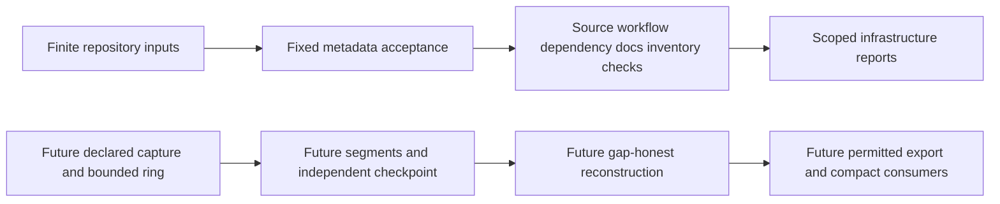

<!--
SPDX-License-Identifier: AGPL-3.0-or-later
Commercial license available
© Concepts 1996–2026 Miroslav Šotek. All rights reserved.
© Code 2020–2026 Miroslav Šotek. All rights reserved.
ORCID: 0009-0009-3560-0851
Contact: www.anulum.li | protoscience@anulum.li
FLIGHT-RECORDER — repository governance and provenance
-->

# Architecture

The implemented surface is local repository validation tooling under tools/recorder_validation. Fixed scripts validate metadata, maintained source and licence provenance, workflow policy, development dependencies, rendered documentation and deterministic inventory. Reports cover only the named infrastructure operation.

Metadata acceptance binds a closed independent schema, repository identity, governance profile, interpreter and raw development lock. Inventory generation creates complete output exclusively; read-only verification does not repair inputs.

The planned recorder captures declared input, output, supported internal-health and package-identity events through bounded simulation and SystemVerilog instrumentation. Python segment admission and reconstruction keep event order, retained-window integrity, independently surviving checkpoint support and full reference closure distinct.

Common representation, signing and current trust stay with EVIDENCE-MANIFEST-TOOLKIT. The recorder owns capture and retained data; Field Ops owns compact health judgments, Deploy Pack owns separately authorized actions, and Ledger owns global lineage. LTW methods inform timebase and buffering without copying its internals. These are future integrations, not installed dependencies.

Read the [component guide](docs/ARCHITECTURE.md), [trust boundaries](docs/THREAT_MODEL.md) and [validation commands](VALIDATION.md).
